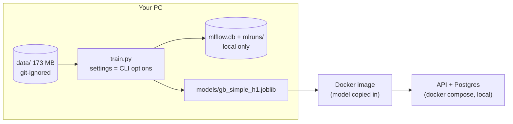
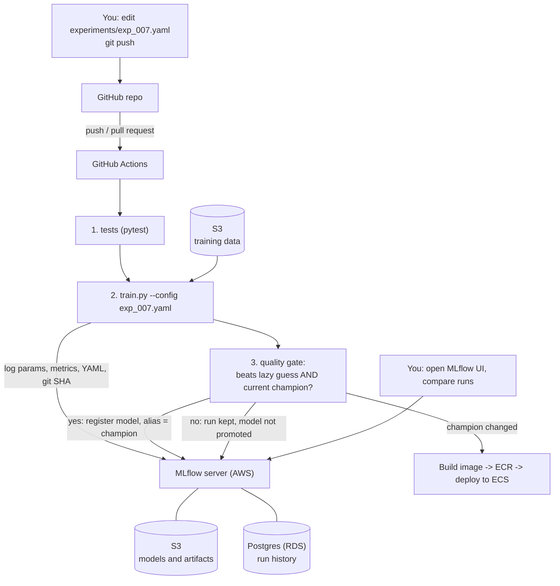
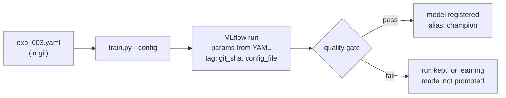
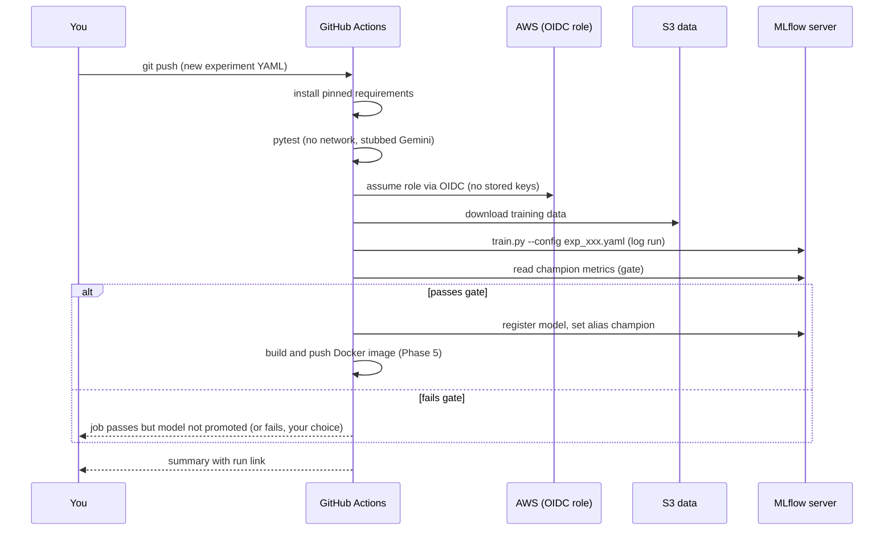
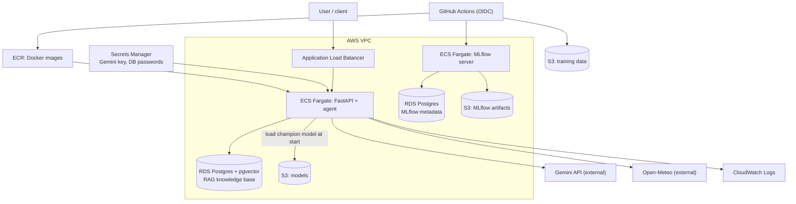
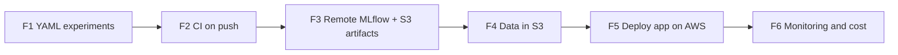

# Plan: YAML experiments, CI pipeline, MLflow, and moving everything to AWS

Made 2026-10-13. Diagrams are Mermaid: they render on GitHub and in VS Code (with a Mermaid preview extension).

## 1. The goal in one paragraph

Every training iteration is described by a **YAML file in git**. When you push to GitHub, a **CI pipeline** reads the
YAML, trains the model, and logs the run to a **shared MLflow server** you can open in the browser. The quality gate
decides whether the new model may replace the current one. Later, data, models and MLflow artifacts live in
**S3**, and the whole application runs on **AWS**.

## 2. Where we are today, and why it must change



Three things block "push -> CI -> MLflow shows it":

| Problem | Why it blocks CI | Fix in this plan |
|---|---|---|
| MLflow is a local SQLite file | A CI machine is thrown away after each run; you cannot see its `mlflow.db` | Remote MLflow server (Phase 3) |
| Training data is git-ignored (173 MB) | A fresh CI machine has no data; re-downloading is slow and rate-limited | Keep the data in S3 (Phase 4) |
| Settings live in command-line options | They are not recorded in git, so you cannot see what each iteration was | One YAML file per iteration (Phase 1) |

## 3. Target picture



## 4. The YAML file (one per iteration)

One file per experiment, named by number so the git history reads as a logbook:

```
experiments/
  exp_001_baseline.yaml
  exp_002_lr005.yaml
  exp_003_iter600.yaml
```

```yaml
# experiments/exp_003_iter600.yaml
name: exp_003_iter600
description: More boosting rounds, everything else as exp_001
model:
  type: HistGradientBoostingRegressor
  max_iter: 600
  learning_rate: 0.1
  random_state: 42
data:
  area: South_Mumbai
  train_until: 2021-12-31
  validation: [2022-01-01, 2023-12-31]
  test: [2024-01-01, 2025-12-31]
gate:
  must_beat_lazy_guess: true
  must_not_be_worse_than_champion: true
```

Rules:
- A YAML file is **never edited after it has run**. A new idea is a new file (so history stays honest).
- `train.py --config experiments/exp_003_iter600.yaml` reads it. The old `--learning-rate` and `--max-iter`
  options can stay as overrides for quick tries, but CI uses only the YAML.
- The run logs the YAML itself as an artifact, the **git commit SHA** and the YAML file name as tags. So from any
  MLflow run you can find the exact code and settings.



## 5. CI pipeline (GitHub Actions) in detail

Trigger: a push or pull request that changes `src/**`, `experiments/**` or `requirements*.txt`.



Important choices:
- **No long-lived AWS keys in GitHub.** Use GitHub's OIDC to assume an IAM role for each job.
- **Gemini key and DB password** go in GitHub Secrets (CI) and AWS Secrets Manager (production). Never in git.
- **Quality gate moves from the local joblib file to the MLflow Model Registry**: "the champion" is the registered
  model with the alias `champion`. CI compares the new model with it.
- Training takes about 20-30 s per run today, so it fits easily in a normal CI job.

## 6. AWS target architecture



| Today | On AWS |
|---|---|
| `docker compose` on your PC | ECS Fargate service behind an ALB |
| Postgres container with pgvector | RDS for PostgreSQL (supports the `pgvector` extension) |
| `models/*.joblib` copied into the image | Champion model loaded from S3 / the registry at start |
| `mlflow.db` + `mlruns/` | MLflow server on ECS + RDS metadata + S3 artifacts |
| `data/` on disk | S3 bucket (versioned) |
| `.env` file | Secrets Manager |
| `print`/logs in terminal | CloudWatch Logs |

## 7. Phases (one lesson at a time, tutor style, like the rest of the course)



| Phase | What we build | Learn first | Done when |
|---|---|---|---|
| **F1. YAML experiments** | `experiments/` folder, `--config` in `train.py`, YAML + git SHA logged to MLflow | YAML basics, `argparse` vs config files, `git rev-parse` | Same results as today from `exp_001_baseline.yaml`; the YAML shows as an artifact in MLflow |
| **F2. CI on push** | `.github/workflows/train.yml`: install, pytest, train. At first logs to a CI-local MLflow and uploads `metrics.json` as a CI artifact (no AWS yet) | GitHub Actions basics, secrets, caching pip | A push runs the job; red/green status matches the gate |
| **F3. Remote MLflow + S3 artifacts** | MLflow server (first on one EC2/Fargate task, SQLite replaced by Postgres), S3 artifact bucket, CI logs to it | S3 basics, IAM roles, MLflow tracking server docs | A push from GitHub makes a run appear in the shared MLflow UI |
| **F4. Data in S3** | Upload the cleaned data to a versioned bucket; CI downloads it; optional DVC | S3 versioning, `boto3`, DVC basics | A clean CI machine trains without hitting Open-Meteo |
| **F5. Deploy on AWS** | ECR image, ECS Fargate service, RDS pgvector, Secrets Manager, ALB; the model is loaded from the registry | ECS/Fargate concepts, VPC basics, RDS, Docker push | `/ask` works on a public URL; a new champion deploys from CI |
| **F6. Monitoring and cost** | CloudWatch logs and alarms, a billing alarm, simple data/prediction checks (the skipped M4/M5) | CloudWatch, AWS Budgets | You get an alert if the API fails or costs pass your limit |

Order matters: F1 and F2 need no AWS account. F3 needs the account. Do not build F5 before F3 and F4.

## 8. Decisions I need from you

| # | Decision | My default |
|---|---|---|
| 1 | AWS region | `ap-south-1` (Mumbai): closest to you |
| 2 | MLflow hosting | ECS Fargate task + RDS (all AWS). Cheaper start: one small EC2 with Docker |
| 3 | Where do tests run? | In CI on every push (needs the stub from lesson E2) |
| 4 | Should a rejected model fail the CI job or just not be promoted? | Not promoted, job stays green; a note in the summary |
| 5 | Data versioning: plain S3 versioning or DVC? | Plain S3 versioning first; DVC later if needed |
| 6 | Monthly budget limit for AWS | Set a billing alarm before F3 |

## 9. Risks

- **Cost:** RDS, Fargate and the load balancer all cost money while running (not free-tier friendly for all parts). Set a billing alarm first. Stop the services when not demoing.
- **Complexity:** this is about 6 new topics (GitHub Actions, IAM, S3, ECS, RDS, Secrets Manager). That is why each phase is one lesson.
- **App Control on your laptop** blocked a compiled library before (SQLAlchemy). AWS CLI, Terraform or Docker tools might hit the same wall: check each install early.
- **Secrets leaks:** never print secrets in CI logs; use OIDC, not stored keys.
- **Reproducibility:** pin the GitHub Action versions and the Python version, as we did for packages.
- **Infrastructure as code** (Terraform or CloudFormation) is the right way to build F3-F5. We learn the console first, then write it as code, so it can be rebuilt.
